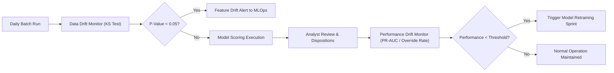

# Finance Data Governance, Internal Controls & Auditability Framework
## Compliance with SOX Section 404, Basel BCBS 239, and Model Risk SR 11-7
**Target Organization:** DTCC CFO Organization / Internal Audit & Compliance  
**Author:** Bhupesh Chandra Dimri | October 2026

---

### 1. Internal Control Objectives (SOX 404 Alignment)
In a systemically important financial market infrastructure (SIFMI) such as DTCC, financial reporting reconciliations underpin institutional trust and regulatory reporting accuracy. The implementation of machine learning risk scoring introduces new model governance obligations:

- **Control Objective 1 (Data Completeness & Integrity):** Ensure 100% of GL transactions from all source systems are ingested, schema-validated, and scored without record loss or duplication.
- **Control Objective 2 (Segregation of Duties & Human-in-the-Loop):** Under no circumstances may an automated AI prediction directly modify General Ledger balances, except for pre-authorized sub-$1.00 rounding write-offs under Finance Policy 402.
- **Control Objective 3 (Model Auditability & Explainability):** Every risk score must be mathematically explainable with decomposed feature contributions and transparent odds ratios.
- **Control Objective 4 (Audit Trail Immutability):** All analyst review dispositions, overrides, and timestamps must be written to write-once-read-many (WORM) audit ledgers.

---

### 2. Critical Data Element (CDE) Validation Rules & Thresholds

The ingestion engine executes 12 automated validation rules before releasing data to the scoring pipeline:

| Rule ID | Critical Data Element | Rule Specification | Severity | Automated Action on Failure |
| :--- | :--- | :--- | :--- | :--- |
| **CDE-01** | `transaction_id` | Must be non-null and unique UUID format | CRITICAL | Abort batch ingestion; alert Data Ops |
| **CDE-02** | `posting_date` | Date within active accounting period | CRITICAL | Reject record to quarantine table |
| **CDE-03** | `entity` | Member of approved DTCC legal entity list | HIGH | Reject record; notify Master Data team |
| **CDE-04** | `account_cat` | Valid COA taxonomy category | HIGH | Route to mapping error review |
| **CDE-05** | `source_system` | Originates from authorized ERP/Billing feeds | HIGH | Block untrusted ingestion origin |
| **CDE-06** | `amount_gl` | Positive numeric balance (`amount_gl > 0`) | HIGH | Reject record |
| **CDE-07** | `mapping_version_age`| Integer >= 0; SLA warning if > 90 days | MEDIUM | Flag with `mapping_stale_flag` |
| **CDE-08** | `posting_lag_days` | Value between 0 and 30 calendar days | MEDIUM | Cap lag at 30; flag outlier |
| **CDE-09** | `days_to_period_end` | Value between 0 and 30 days | MEDIUM | Recalculate from calendar table |
| **CDE-10** | `vendor_dup_flag` | Binary indicator (0 or 1) | HIGH | If 1, assign `CRITICAL` queue priority |
| **CDE-11** | `abs_diff` | Quarantined from pre-close feature table | CRITICAL | Enforce firewall; abort if in features |
| **CDE-12** | `is_break` | Ground truth label (0 or 1) | HIGH | Target validation |

---

### 3. Human Override & Disposition Policy

To satisfy Model Risk Management requirements, analysts retain absolute authority over triage disposition:

1. **Disposition Options:**
   - `CONFIRM BREAK`: Analyst agrees with model; item escalated for sub-ledger investigation.
   - `DISMISS (FALSE ALARM)`: Analyst verifies transaction is matched; score deemed false positive.
   - `RECLASSIFY CAUSE`: Analyst overrides model root cause (e.g., changes `timing` to `mapping_error`).
   - `AUTO-CLEAR APPROVED`: Sub-$1.00 rounding discrepancy approved for automated GL variance clearance.
2. **Override Documentation Requirement:**
   - Any override on an item scoring in the top 5% of risk requires mandatory entry of an `override_rationale` text field.
3. **Override Monitoring:**
   - If the analyst override rate exceeds 20% in any rolling 30-day window, Model Risk Management initiates an immediate model review.

---

### 4. Ongoing Model Monitoring & Drift Governance Protocol

#### Drift Thresholds:
- **Feature Drift (Population Stability Index - PSI):**
  - $PSI < 0.10$: No significant change; continue standard scoring.
  - $0.10 \le PSI < 0.25$: Moderate drift; issue alert to Finance Analytics team.
  - $PSI \ge 0.25$: Significant shift; suspend automated prioritization and alert Controller.
- **Performance Drift:**
  - Holdout PR-AUC evaluated monthly against verified close ground truth.
  - Retraining required if PR-AUC drops below 0.20 or top-10% capture falls below 25%.
