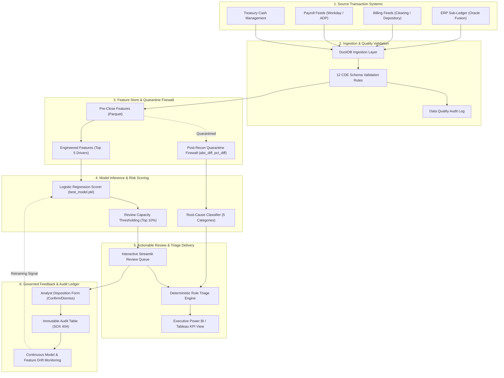

# End-to-End Data Lineage & Pipeline Architecture
## Reconciliation Break-Risk Scorer and Root-Cause Triage
**Target Organization:** DTCC CFO / Financial Technology Architecture  
**Standards:** BCBS 239 Data Lineage Governance & Auditability  
**Author:** Bhupesh Chandra Dimri | October 2026

---

### 1. Visual Pipeline Flowchart

---

### 2. Lineage Transformation Stages

#### Stage 1: Source Ingestion
- **Extracts:** Daily incremental journal files extracted from ERP, Billing, Payroll, and Treasury systems.
- **Protocol:** Nightly batch SFTP / Kafka ingestion into raw staging directory.
- **Audit Verification:** Hash sum verification and record counts checked against source transmission manifests.

#### Stage 2: Schema & CDE Validation
- **Engine:** Python / DuckDB SQL.
- **Rules:** 12 CDE integrity checks: non-null transaction IDs, valid date sequences, entity taxonomy validation, positive monetary values, and lag boundaries.
- **Exception Routing:** Malformed records routed to dead-letter quarantine table with alerts issued to IT Operations.

#### Stage 3: Feature Engineering & Pre-Close Firewall
- **Storage:** Snappy-compressed Apache Parquet feature store.
- **Top 5 Transformations:**
  1. `is_close_window`: Boolean indicator for `days_to_period_end <= 3`.
  2. `close_manual_interaction`: Interaction term crossing close window with manual journal flag.
  3. `mapping_stale_flag`: Indicator for `mapping_version_age_days > 90`.
  4. `posting_lag_ratio`: Transaction posting lag divided by historical source system median lag.
  5. `log_amount_gl`: Natural logarithm of monetary balance (`log1p`).
- **Firewall:** Strict physical isolation of post-reconciliation discrepancy attributes (`abs_diff`, `pct_diff`) preventing circular leakage into Problem 1.

#### Stage 4: Scoring & Multi-Class Classification
- **Batch Frequency:** Nightly batch inference (executed at 02:00 EST).
- **Execution:** Vectorized Scikit-Learn pipeline scoring 100% of pending items in < 5 seconds.
- **Outputs:** Probability score (`risk_score` $\in [0, 1]$), review priority tier (`CRITICAL`, `HIGH`, `MEDIUM`, `LOW`), and predicted root cause.

#### Stage 5: Delivery & Analyst Workflow
- **Interfaces:** Streamlit operational queue for reconciliation analysts; Power BI summary dashboard for Controllers.
- **Triage Action:** Rule-based deterministic explanation engine generating plain-English root cause summary and remedial recommendation.

#### Stage 6: Feedback Loop & Model Governance
- **Audit Logging:** Every analyst action (`Confirm Break`, `Dismiss False Alarm`, `Reclassify Cause`, `Auto-Clear Approved`) is persisted with analyst ID and timestamp.
- **Retraining Cycle:** Monthly rolling-origin model recalibration incorporating verified analyst ground truth.
- **Drift Detection:** Kolmogorov-Smirnov statistical tests executed weekly to identify feature drift in mapping age and posting lag distributions.
